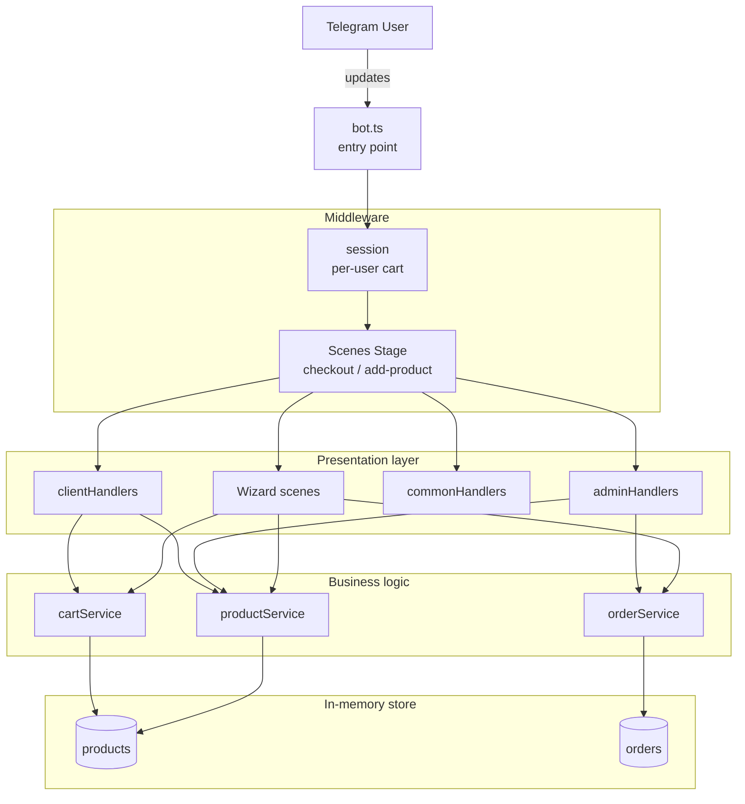
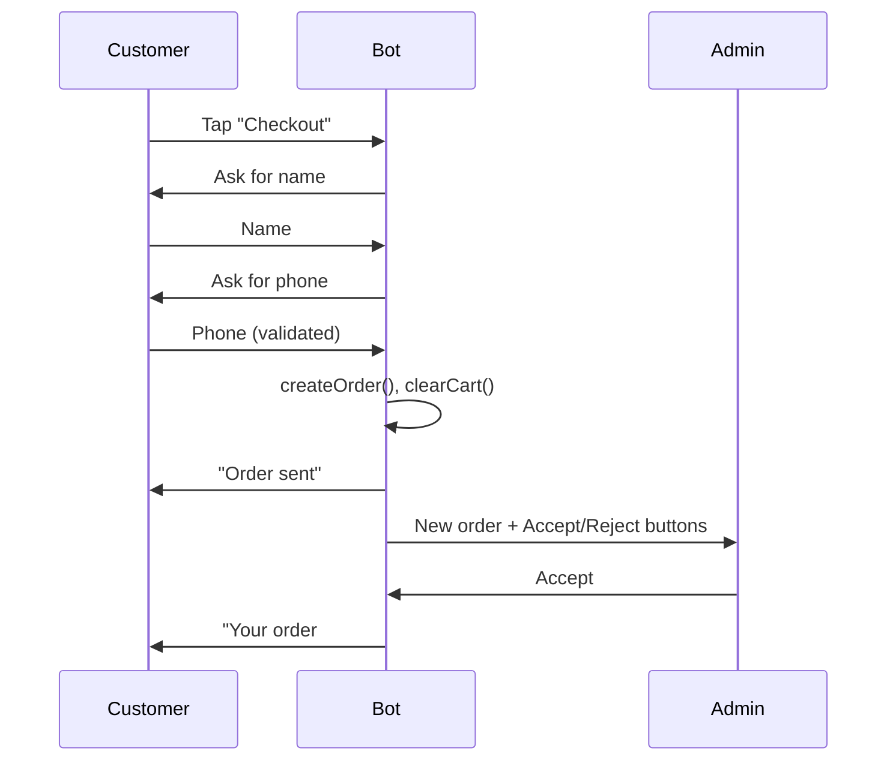

# ☕ Coffee Bot — Telegram Ordering System

> A production-style Telegram bot for a coffee shop: customers browse the menu, build a cart and place orders; staff manage the catalog and process orders in real time — all inside a single Telegram chat.

**Stack:** Node.js · TypeScript · [Telegraf 4](https://telegraf.js.org/) · dotenv

🌐 *[Русская версия README](README.ru.md)*

---

## Overview

Coffee Bot turns a Telegram chat into a complete ordering channel for a small coffee shop. It serves **two roles from one bot**:

- **Customers** browse the menu by category, pick a drink size, manage a cart, and check out through a guided dialog.
- **The shop (admin)** manages the product catalog, toggles item availability, and accepts or rejects incoming orders — with instant push notifications in both directions.

The project was built to practice designing a stateful, role-aware conversational application with a clean, layered architecture rather than a single monolithic handler file.

## Why it's interesting (engineering highlights)

- **Layered architecture** — presentation (handlers/keyboards), business logic (services), and data are cleanly separated, so UI changes never leak into business rules.
- **Multi-step conversations** via Telegraf **Wizard Scenes** — checkout and "add product" are modeled as explicit, resumable step machines with per-step validation.
- **Role-based access control** — admin-only actions are gated by a guard that checks the Telegram user ID against a configured admin, applied consistently across every privileged handler and callback.
- **Two-way order lifecycle** — orders move through `pending → accepted / rejected`; the admin is notified of new orders, and the customer is automatically notified when their order is accepted or rejected.
- **Resilience built in** — automatic launch **retry with backoff** on transient network errors, optional outbound **HTTPS proxy**, a global error handler, and **graceful shutdown** on `SIGINT` / `SIGTERM`.
- **Typed domain model** — orders, products, cart items and sizes are described with explicit TypeScript interfaces and union types.

## Features

### Customer

| Feature | Description |
| --- | --- |
| Browse menu | Categories → products, driven by inline keyboards |
| Size selection | `S / M / L` for drinks with per-size price multipliers; desserts are single-size |
| Cart | Add items, remove specific lines, view running total |
| Guided checkout | Wizard scene collects name and phone with validation |
| Order confirmation | Order is created, cart is cleared to prevent double-submit |
| Status updates | Automatic notification when the order is accepted or rejected |

### Admin

| Feature | Description |
| --- | --- |
| View catalog | List every product with category, price and availability |
| Add product | Wizard scene: name → category → price, each step validated |
| Delete product | Remove an item from the catalog |
| Toggle availability | Hide/show a product without deleting it |
| View orders | List all orders; act on the ones still pending |
| Accept / reject | One-tap decision that notifies the customer |
| New-order alerts | Push notification with full order details on every new order |

## Architecture



The dependency rule points inward: **handlers depend on services, services depend on data — never the reverse.** Keyboards are pure view builders with no business logic.

### Order placement flow



### Project structure

```text
src
├── bot.ts                     # Composition root: wiring, middleware, launch & lifecycle
├── types.ts                   # Domain types (Product, Order, CartItem, sizes, statuses)
├── data/                      # In-memory data sources
│   ├── products.ts
│   └── orders.ts
├── handlers/                  # Presentation layer (Telegram update handlers)
│   ├── clientHandlers.ts      # Customer menu, cart, checkout entry
│   ├── adminHandlers.ts       # Catalog & order management (admin-guarded)
│   ├── commonHandlers.ts      # /start, /cancel, role routing
│   └── scenes/                # Multi-step wizard dialogs
│       ├── checkoutScene.ts
│       └── addProductScene.ts
├── keyboards/                 # View layer: inline & reply keyboard builders
│   ├── inlineKeyboards.ts
│   └── replyKeyboards.ts
└── services/                  # Business logic
    ├── cartService.ts         # Cart ops, size pricing, totals
    ├── orderService.ts        # Order lifecycle & formatting
    └── productService.ts      # Catalog CRUD & queries
```

## Tech stack

| Concern | Choice | Rationale |
| --- | --- | --- |
| Runtime | **Node.js** | Event-driven model fits a chat bot's I/O workload |
| Language | **TypeScript** | Typed domain model; safer refactoring |
| Bot framework | **Telegraf 4** | First-class middleware, Scenes, and keyboard APIs |
| Config | **dotenv** | Secrets and environment kept out of source |
| Networking | **https-proxy-agent** | Reach the Telegram API from restricted networks |
| Storage | **In-memory** | Zero-setup for a demo (see trade-offs below) |

## Getting started

### Prerequisites

- Node.js 18+
- A Telegram bot token from [@BotFather](https://t.me/BotFather)
- Your numeric Telegram user ID (e.g. via [@userinfobot](https://t.me/userinfobot)) to act as admin

### Setup

```bash
# 1. Install dependencies
npm install

# 2. Configure environment
cp .env.example .env
# then edit .env:
#   BOT_TOKEN=<your bot token>
#   ADMIN_ID=<your telegram id>
#   HTTPS_PROXY=...   # optional, only if the Telegram API is blocked on your network

# 3. Run in watch mode
npm run dev
```

Open your bot in Telegram and send `/start`. If your ID matches `ADMIN_ID`, you'll see the admin keyboard; otherwise you get the customer menu.

### Scripts

| Script | Description |
| --- | --- |
| `npm run dev` | Hot-reloading development server (`ts-node-dev`) |
| `npm run build` | Compile TypeScript to `dist/` |
| `npm start` | Run the compiled bot |

### Environment variables

| Variable | Required | Description |
| --- | --- | --- |
| `BOT_TOKEN` | ✅ | Telegram bot token from BotFather |
| `ADMIN_ID` | ✅ | Telegram user ID that gets admin privileges |
| `HTTPS_PROXY` | ⬜ | Optional HTTP/HTTPS proxy for reaching `api.telegram.org` |

## Design decisions & trade-offs

These were made deliberately for a focused demo, and I'm explicit about where the current boundaries are:

- **In-memory storage.** Products, orders and carts live in process memory, so there are zero infrastructure dependencies to run the demo — but **all state is lost on restart**. The data layer is isolated behind service functions specifically so it can be swapped for a real database with no changes to handlers.
- **Single admin via env var.** Access control is simple and good enough for one shop; a multi-admin or role table would be the next step.
- **Pragmatic typing.** The context type is loose (`any`) and `strict` is off in `tsconfig`, which kept iteration fast. Tightening the context type and enabling strict mode is an easy, high-value follow-up.
- **No automated tests yet.** The service layer is pure and framework-free, so it's structured to be unit-testable without a running bot.

## Production roadmap

What I would add to take this from a polished demo to production:

- **Persistence** — PostgreSQL (via Prisma) for catalog/orders, Redis for sessions, keeping the existing service boundaries.
- **Payments** — Telegram Payments API for in-chat checkout.
- **Internationalization** — extract the UI strings (currently Russian) into an i18n layer with an English locale.
- **Webhook mode + scaling** — switch from long polling to webhooks behind a load balancer for horizontal scaling.
- **Testing & CI** — unit tests for services, integration tests for scenes, and a GitHub Actions pipeline.
- **Observability** — structured logging and error reporting (e.g. pino + Sentry).
- **Hardening** — rate limiting, stricter input validation, and typed Telegraf context.
- **Delivery** — Dockerfile and container-based deployment.

## License

MIT
